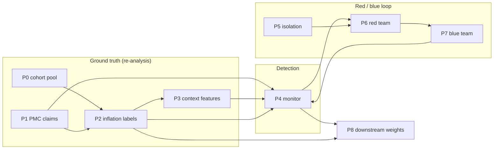

# compbio-claim-inflation

Ground-truth engine, content-only detector and red-team/blue-team harness for
**inflation in computational-biology claims** — published prognostic claims that
look stronger than the public data supports.

Given a claim such as *"high expression of gene X predicts poor overall survival
in liver cancer"*, the harness re-analyses public cohorts to measure the claim's
inflation, trains a detector that predicts inflation from the manuscript alone,
and runs isolated red-team agents that try to write inflated claims the detector
misses.

Implementation of the specification in [`docs/spec.md`](docs/spec.md) (v1.2).
The honest, dated state of every acceptance criterion is in
[`docs/status.md`](docs/status.md); defects found in earlier passes and their
fixes are in [`docs/audit.md`](docs/audit.md).

## What it does

| Stage | Module | Purpose |
|---|---|---|
| P0 | `cbi.cohort_pool` | Standardised public cohort pool (GEO/TCGA/ICGC/CPTAC), frozen whole-cohort split |
| P1 | `cbi.m1` | LLM claim extraction from PMC Open Access papers, plus a deterministic consistency audit |
| P2 | `cbi.m2` | Ground-truth inflation: re-fit the claim in independent cohorts, random-effects meta-analysis, multiverse baseline |
| P3 | `cbi.m3` | As-of context features (citations, replication history, cohort availability) |
| P4 | `cbi.m4` | Content-only monitor: section-aware document, eight red flags, calibrated evidence score |
| P5 | `cbi.m5` | Isolation acceptance for red-team workers (sandbox, grader, log integrity) |
| P6 | `cbi.m5` | Red-team campaign: isolated workers submit analysis code + manuscript, grader scores blind spots |
| P7 | `cbi.m7` | Blue-team loop: retrain on red-team discoveries, promote only accepted candidates |
| P8 | `cbi.m8` | Downstream interface: claim weights exported for knowledge-graph / label use |



## Status

Short version: the infrastructure is complete and tested offline; the detector's
real-data result is **pending**, because the 391-claim scoring run needs a
provider API window.

| Stage | State | Note |
|---|---|---|
| P0 | Partial | 22 real cohorts (LIHC/BRCA/LUAD/KIRC); KIRC has 4 instead of the specified 5 |
| P1 | Not accepted | 4,025 papers → 531 valid claims; yield 13.2% (spec flags <20%), audit pass 52.1% |
| P2 | Not accepted | 391 label-eligible claims; positive control passes, negative control fails (0.278) |
| P3 | Pass (formal) | 496/496 coverage, mean field coverage 0.540 |
| P4 | **Pending** | v1 AUC 0.453 is invalid (truncated input); v2 built and cached, not scored |
| P5 | Pass | 7/7 isolation checks, detector-independent |
| P6 | Invalid | Ran against the v1 near-chance detector; do not cite |
| P7 | Implemented | Three-cycle control flow tested offline; live acceptance pending P4 v2 |
| P8 | Stale | Still the 34-claim example; rerun after P4 v2 |

Details and artifact paths: [`docs/status.md`](docs/status.md),
[`docs/handoff.md`](docs/handoff.md).

## Install

Python 3.11+.

```bash
git clone <repo-url> compbio-claim-inflation
cd compbio-claim-inflation
python3 -m venv .venv && source .venv/bin/activate
pip install -e ".[test]"          # add plot,api for figures and the HTTP grader
```

The package uses a `src/` layout. Run commands from the repository root: the
project root is resolved from `--root`, `CBI_ROOT`, or the nearest parent
directory containing `configs/mvp.yaml`.

## Quickstart (no API, no data download)

```bash
python3 -m cbi.cli status          # config, detector and data availability
python3 -m pytest -q               # offline test suite
```

`status` works on a fresh clone. The stages that need real data fail closed
instead of falling back to synthetic data:

```bash
python3 -m cbi.cli p4 --prepare-only   # builds/reuses monitor docs, reports cache readiness
python3 -m cbi.cli p4 --offline        # trains only from a complete valid score cache
```

## Pipeline

| Command | Needs | Output |
|---|---|---|
| `python3 -m cbi.cli status` | — | JSON state of config, detector, data |
| `python3 -m cbi.cli p0` | GEO/TCGA/ICGC/CPTAC downloads | `configs/cohort_pool.yaml`, `configs/cohort_split.yaml` |
| `python3 -m cbi.cli p1 --workers 10 --batch-size 4` | LLM endpoint + PMC cache | `reports/P1_public_pmc.md` |
| `python3 -m cbi.cli p2` | cohort data | `reports/P2_real.md`, `data/processed/<snapshot>/ground_truth.json` |
| `python3 -m cbi.cli p3` | `data/raw/context/context.json` | `reports/P3_context.md` |
| `python3 -m cbi.cli p4` | LLM endpoint | `reports/P4_llm_v2.md`, `models/detector_llm_v2/` |
| `python3 -m cbi.cli p5` | — | `reports/P5_summary.md` |
| `python3 -m cbi.cli p6 --rounds 1 --workers 1` | detector + `CBI_GRADER_TOKEN` | `redteam_artifacts/`, `reports/P6_summary.md` |
| `python3 -m cbi.cli p7 --rounds 3` | P4 v2 + P6 logs + API | `models/blue_llm/`, `reports/P7_summary.md` |
| `python3 -m cbi.cli p8` | detector | `reports/claim_weights.csv`, `reports/P8_downstream.md` |

Data acquisition helpers:

```bash
# PMC Open Access XML cache (needs NCBI_API_KEY for the 3 req/s limit)
python3 -m cbi.m1.pmc_fetch --limit 100 --out data/raw/pmc_real
python3 -m cbi.m1.public_audit --dir data/raw/pmc_real --workers 8

# GEO cohort ingestion and a direct Cox evaluation
python3 -m cbi.cohort_pool.geo --gse GSE76427 --out data/raw/geo/GSE76427
python3 -m cbi.m2.real_cohort --cohort data/raw/geo/GSE76427 --genes TP53,MKI67

# Offline audits
python3 scripts/audit_corpus.py        # reports/corpus_audit.{json,md}
python3 scripts/analyze_m2_null.py     # reports/M2_null_analysis.{json,md}
```

P4 has two no-cost modes: `--prepare-only` builds documents and reports cache
readiness without contacting the endpoint; `--offline` calibrates and saves a
detector only when every eligible score is already cached. Normal mode probes
the endpoint first and aborts before sending any scoring request if it is
closed. Scores are written per finished request, so an interrupted run resumes
where it stopped.

## Configuration

```bash
cp .env.example secrets/llm.env      # secrets/ is git-ignored
set -a && source secrets/llm.env && set +a
```

Required for M1/M4/M5/P7: an OpenAI-compatible chat-completions endpoint
(`CBI_LLM_ENDPOINT`, `CBI_LLM_MODEL`, `CBI_LLM_API_KEY`; `OPENAI_BASE_URL`,
`OPENAI_MODEL`, `OPENAI_API_KEY` are accepted as fallbacks). Batching and
concurrency: `CBI_M1_BATCH_SIZE`, `CBI_EVIDENCE_BATCH_SIZE`,
`CBI_M5_SCORE_BATCH`, `CBI_LLM_MAX_CONCURRENCY`. Every batch parser is
fail-closed: a missing item is retried singly, never scored as zero.

Files in `configs/`:

| File | Contents |
|---|---|
| `mvp.yaml` | snapshot id, seed, cancers, as-of variant |
| `cohort_pool.yaml` | 22-cohort pool with sample and event counts |
| `cohort_split.yaml` | frozen dev / visible_eval / heldout roles |
| `scoring.yaml` | ground-truth scoring parameters |
| `choice_registry.yaml` | red-team analysis-choice registry |
| `detector_lexicon.yaml` | lexicon features for the checklist ablation |
| `redteam.yaml`, `blue.yaml` | campaign and blue-cycle settings |

## Repository layout

```
.
├── src/cbi/                 # package: pipeline, modules m1–m8, cohort_pool
├── tests/                   # offline unit and regression tests
├── scripts/                 # data ingestion, audits, report builders
├── configs/                 # frozen pipeline configuration
├── docs/                    # spec, status, audit, handoff, deployment, archive
├── reports/                 # curated markdown results (data dumps are ignored)
├── data/                    # source/derived data — git-ignored, see data/README.md
├── models/                  # trained detectors — git-ignored
├── logs/, redteam_artifacts/ # runtime output — git-ignored
└── secrets/                 # credentials — git-ignored
```

## Tests

```bash
python3 -m pytest -q
```

Coverage: schemas, inflation table, direction alignment, REML/metafor, Cox,
log-rank, maxstat, HGNC alias resolution, PMC zip/XML/table parsing, GEO cache
and series-matrix parsing, M1 consistency audit, M1/M4 batch alignment, M3
`as_of_date` truncation, P8 prior aggregation, P4 offline training and cache
provenance, three-cycle P7 control flow, corpus audit and M2 statistic
regressions. Tests use synthetic in-memory fixtures only — never synthetic
cohort data. P7 tests use deterministic fake scorers.

## Data, secrets and artifacts

- `data/`, `models/`, `logs/`, `redteam_artifacts/` and `secrets/` are
  git-ignored. Nothing in this repository is a credential; `.env.example` shows
  the variable names.
- `reports/*.json` and `reports/*.csv` are ignored because they contain
  per-paper claim data; the curated markdown summaries are tracked.
- Public source data is redistributable only under its own terms (GEO, TCGA,
  ICGC, CPTAC, PMC Open Access). Fetch and cite the originals.
- `docs/archive/freeze-2026-11-01.*` is the manifest of the 2026-11-01 snapshot,
  kept for provenance; it is historical and is not re-frozen.

## Limitations

- M1 without a model is intentionally blocked; rules are validation only.
- The GEO ingester handles common `!Sample_characteristics_ch1` layouts; cohorts
  with survival only in supplements/PDFs need a separate parser.
- P4 v1 is not a ceiling: its judge saw only the first 6,000 characters of each
  manuscript. P4 v2 is built but unscored.
- P6 and P8 numbers in `reports/` predate P4 v2 and must not be cited as current.
- No human-audit step is part of acceptance (spec v1.2, R9).

## Documentation

- [`docs/spec.md`](docs/spec.md) — implementation specification v1.2 (Chinese)
- [`docs/status.md`](docs/status.md) — acceptance status, with evidence
- [`docs/audit.md`](docs/audit.md) — defects found and fixes
- [`docs/handoff.md`](docs/handoff.md) — operator handoff and next commands
- [`docs/deployment.md`](docs/deployment.md) — OS-level grader/worker separation
- [`docs/redteam-worker-briefing.md`](docs/redteam-worker-briefing.md) — worker brief
- [`CHANGELOG.md`](CHANGELOG.md) — release notes

## 中文摘要

本项目把「计算生物学文献结论的水分」做成可计算的流程：用公开队列重分析得到
膨胀度真值（P0–P2），只用论文内容训练检测器（P4），再让隔离的红队 agent 用真实
公开数据写夸大结论去骗检测器（P5–P6），蓝队按盲区加固（P7），最后导出下游可用
的结论权重（P8）。

当前状态：基础设施完成、离线测试通过；**P4 检测器的真实数据结果待跑**（需要
provider API 窗口）。P6/P8 现有数字来自已作废的 v1 检测器，不要引用。数据、模型、
日志、`secrets/` 全部不入库。

## License

[MIT](LICENSE). Third-party data keeps its own license.
